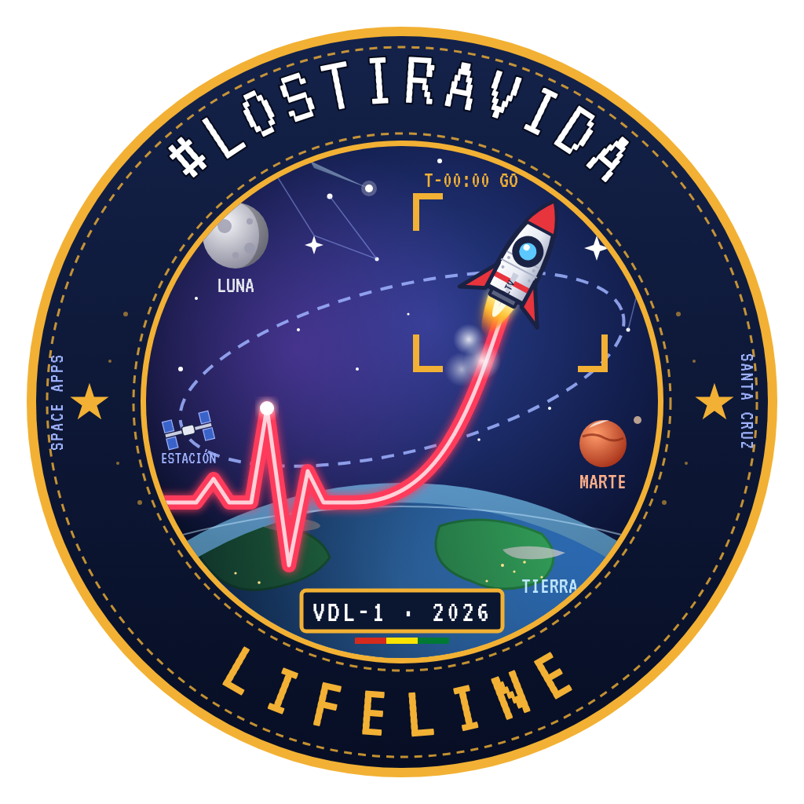
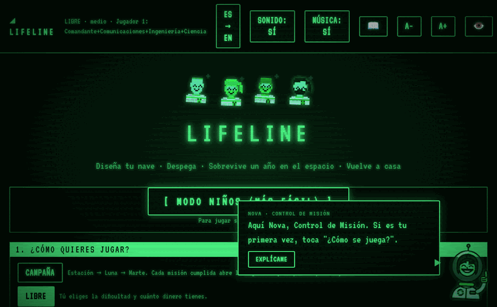
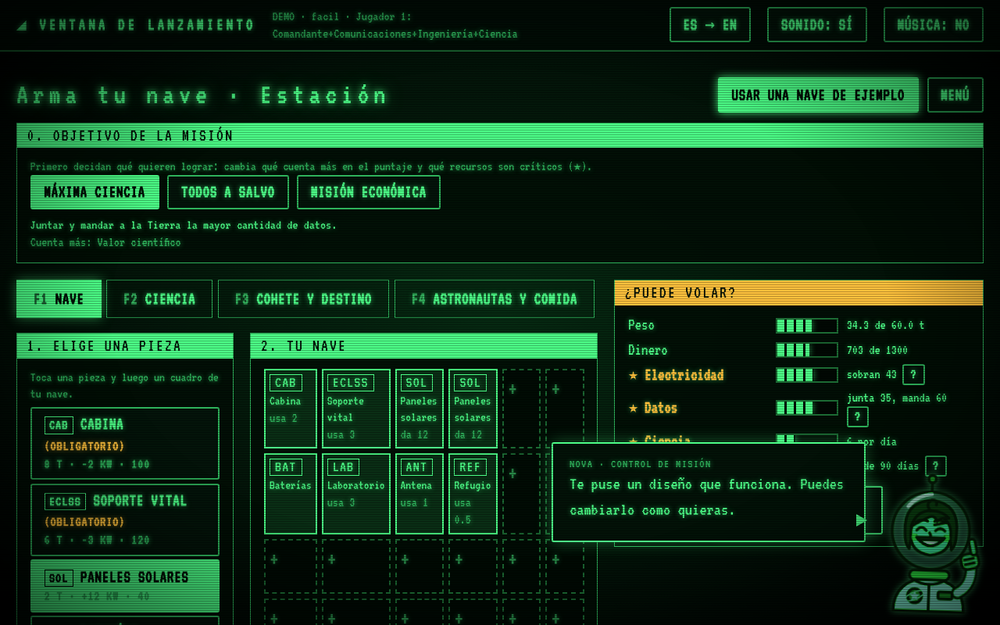
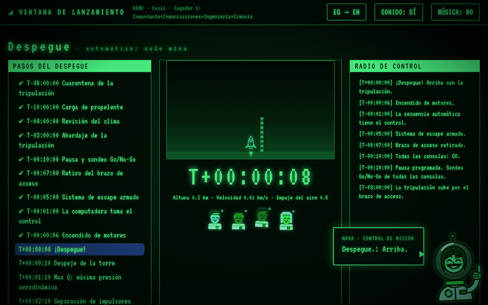
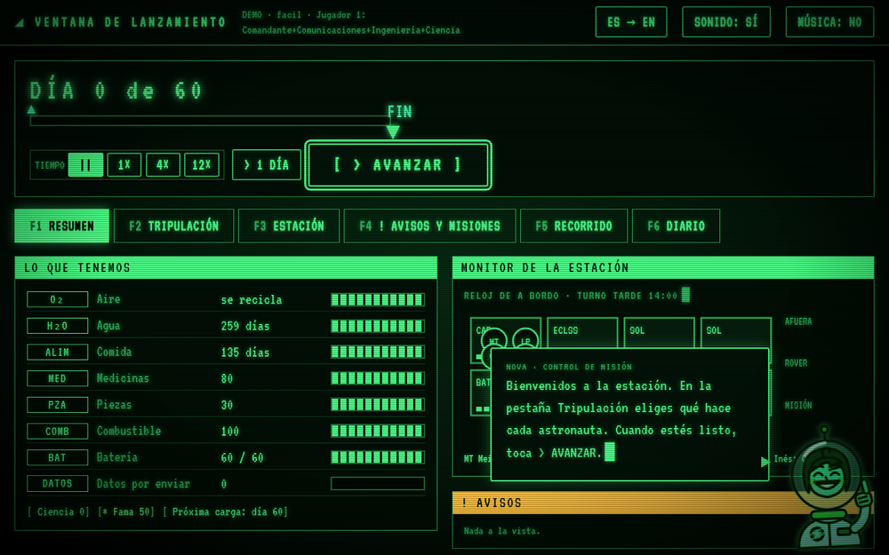
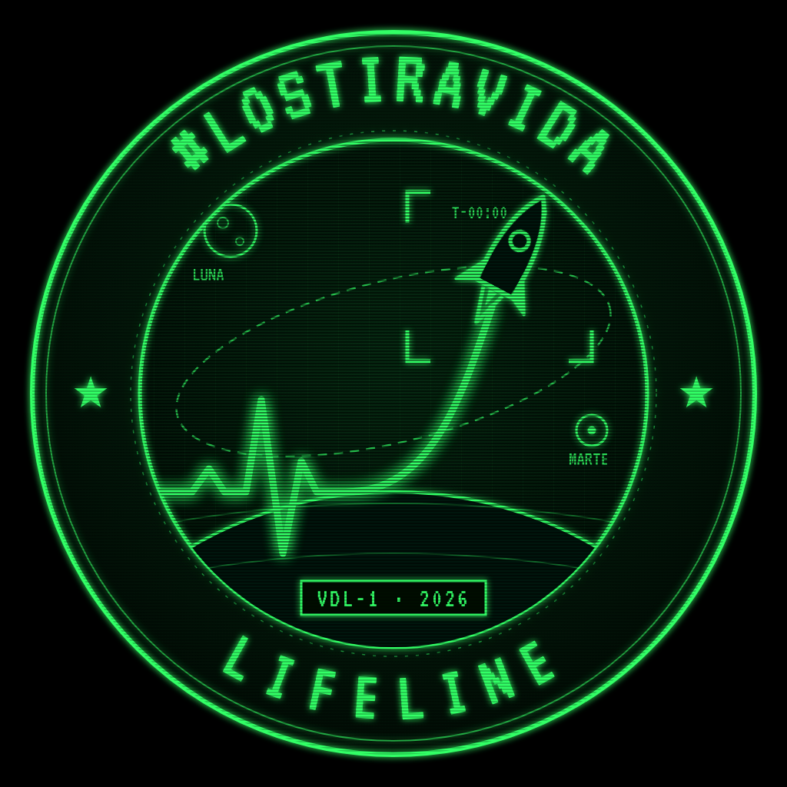

<div align="center">





### Mantén viva a tu tripulación. Un año. En el espacio.

Juego de navegador del equipo **#LosTiraVida** para el **NASA Space Apps Challenge 2026**.

<a href="https://neckhurtttt.github.io/Lifeline/"></a>
<a href="https://neckhurtttt.github.io/Lifeline/ninos/"></a>
<a href="https://github.com/NeckHurtttt/Lifeline/releases/latest"></a>




<sub>Inicio → armar la nave → despegue → <b>¡impacto de micrometeorito!</b> → cerrar escotillas y parchar la fuga</sub>

</div>


## 🛰️ Qué es

Diseñas una misión, la lanzas con un conteo real (clima, Go/No-Go, Max Q, abortos), **mantienes viva
a la tripulación durante un año** (aire, agua, comida, energía, piezas, radiación, turnos de trabajo,
eventos y tormentas solares reales de NASA DONKI), vuelves con la reentrada y recibes un informe con
lo que pasó y lecciones para la Tierra.

<div align="center">

</div>

## 🚀 Cómo se juega

<table>
<tr>
<td align="center" width="33%"><br><b>1 · ARMA TU NAVE</b><br><sub>Módulos en cuadrícula, peso, dinero y energía.</sub></td>
<td align="center" width="33%"><br><b>2 · DESPEGA</b><br><sub>Cuenta regresiva real y votación Go/No-Go.</sub></td>
<td align="center" width="33%"><br><b>3 · SOBREVIVE</b><br><sub>Un año de turnos, recursos y emergencias.</sub></td>
</tr>
</table>

## ✨ Lo que hay dentro

| | |
|---|---|
| 🎓 **Academia de astronautas** | 6 pruebas: gravedad cero, acople, brazo robótico, caminar en la Luna, centrífuga y rover con retraso de señal. Tus estrellas mejoran a la tripulación. |
| 🚀 **Despegue real** | Cuenta regresiva, votación Go/No-Go, Max Q y abortos. |
| ⚡ **37 emergencias relámpago** | Meteoritos, incendios, fugas y cortocircuitos que se resuelven en segundos con minijuegos: escotillas, válvulas, cables, protocolos y códigos. |
| 🫁 **Soporte vital** | Aire, agua, comida, energía, piezas y radiación con datos reales. |
| 👩‍🚀 **Tripulación** | Contratación por entrevista y trabajos que se asignan arrastrando, o con reparto automático. |
| 🌐 **Cooperativo en línea** | Cada jugador tiene un rol (Comandante, Ingeniería, Ciencia, Comunicaciones) desde su propia compu. |
| 🧒 **Modo niños** | Menos números, letra grande, una alarma a la vez y estrellas al final. |
| 📜 **Misiones históricas** | Apolo 13, Skylab, Mir 1997 y la Estación en 2015. |
| 🏆 **Logros y retos** | 13 logros, récords, contrarreloj y quiz final. |

## 🌍 Destinos

| | Destino | Lo difícil |
|:-:|---|---|
| 🛰️ | **Estación espacial** | 1 año en órbita, carga cada 60 días. |
| 🌒 | **Gateway lunar** | Estación alrededor de la Luna, carga cada 180 días. |
| 🌕 | **Base lunar** | Noches de hasta 14 días, hielo, rovers, alunizaje y despegue lunar. |
| 🔴 | **Marte** | 7 meses de ida, 1 año en la superficie y 7 de vuelta: "7 minutos de terror", combustible fabricado allá, tormentas de polvo, retraso de radio y protección planetaria. |

También: protocolos NASA (EVA en pareja con pre-respiración, despresurización con tiempo de reserva,
ejercicio obligatorio…), campaña Estación → Luna → Marte con árbol de mejoras y la guía **Nova**.

> Agencia ficticia. Inspirado en procedimientos y datos abiertos de NASA.


## 🤝 Lo que trajimos de los otros juegos del equipo

Este juego junta las mejores ideas de tres prototipos del equipo:

- **[V · Mission Control](https://github.com/alejondr3/v-)**: cooperativo **en línea** de 2 a 4 personas (cada una en su compu, con un código de sala) y **recorrer la base** caminando con A/D para **reparar a mano** con procedimientos técnicos (presión de cabina, banda S, bus eléctrico, plantas con hongos).
- **[Los Tira Vida 02](https://github.com/alejondr3/Lostiravida2)**: **EVA de excavación** en vista lateral en la Luna y Marte (hielo → agua, hierro → piezas, rocas raras → ciencia, regolito → muro contra la radiación). La música ahora es propia (ambiental espacial generada por código, `src/ui/music.js`).
- Datos de radiación con fuente: estación ~0,5 mSv/día, Luna ~1,4 (Chang'E-4), Marte ~0,64 (Curiosity), límite de carrera NASA 600 mSv.

El cooperativo en línea usa PeerJS (WebRTC) y necesita internet; todo lo demás funciona también en `Jugar.html` sin conexión.

## 🧰 Herramientas, datos y uso de IA

Space Apps pide documentar el software y los servicios de terceros. Este juego usa:

| Qué | Para qué | Licencia / nota |
|---|---|---|
| [PeerJS](https://peerjs.com/) 1.5.4 (desde jsDelivr) | Cooperativo en línea (WebRTC) | MIT; solo se carga al crear o unirse a una sala |
| [esbuild](https://esbuild.github.io/) (vía `npx`) | Empaquetar `Jugar.html` | MIT; solo en desarrollo |
| API DONKI de NASA | Fechas reales de llamaradas solares (con respaldo de 2024 sin conexión) | Datos abiertos de NASA |
| Fuente VT323 | Letra de consola | SIL Open Font License |
| Claude (Anthropic) | Asistente de IA usado para programar y redactar con el equipo | Las decisiones de diseño y las pruebas son del equipo |

Datos de radiación: Chang'E-4 LND (Luna), MSL/Curiosity RAD (Marte), NASA-STD-3001 (límite de carrera).

## ▶️ Jugar

**En línea:** https://neckhurtttt.github.io/Lifeline/

**Descargado, sin internet ni instalar nada:**

1. Baja `Jugar.html` desde [Releases](https://github.com/NeckHurtttt/Lifeline/releases/latest)
   (o *Code → Download ZIP* y descomprime).
2. Abre `Jugar.html` con doble clic. Funciona en Chrome, Firefox y Edge.

**Para programar** (usa los archivos sueltos de `src/`):

```sh
python3 scripts/servir.py      # http://127.0.0.1:8000
node scripts/empaquetar.mjs    # regenera Jugar.html (un solo archivo)
```

## 🧪 Pruebas

```sh
npm test    # node --test, lógica del juego en src/core/
node scripts/balance.mjs 30   # simula partidas por destino y dificultad
```

## 🗂️ Estructura

- `src/core/` — lógica pura y determinista (con semilla): diseño, misión, vida diaria, energía, labores,
  eventos, minimisiones, datos reales, despegue, reentrada, simulación, informe y guardado.
- `src/data/` — catálogo de módulos, cohetes, órbitas, tripulación, eventos, minimisiones y lecciones.
- `src/ui/` — pantallas (menú, diseño, despegue, operaciones, reentrada, informe) y sonido WebAudio.
- `docs/superpowers/plans/` — plan por capas (1 estación · 2 Luna · 3 Marte · 4 campaña).


<div align="center">



**Hecho por #LosTiraVida** · NASA Space Apps Challenge 2026 · Santa Cruz, Bolivia 🇧🇴

<sub>T-00:00 · GO</sub>

</div>
